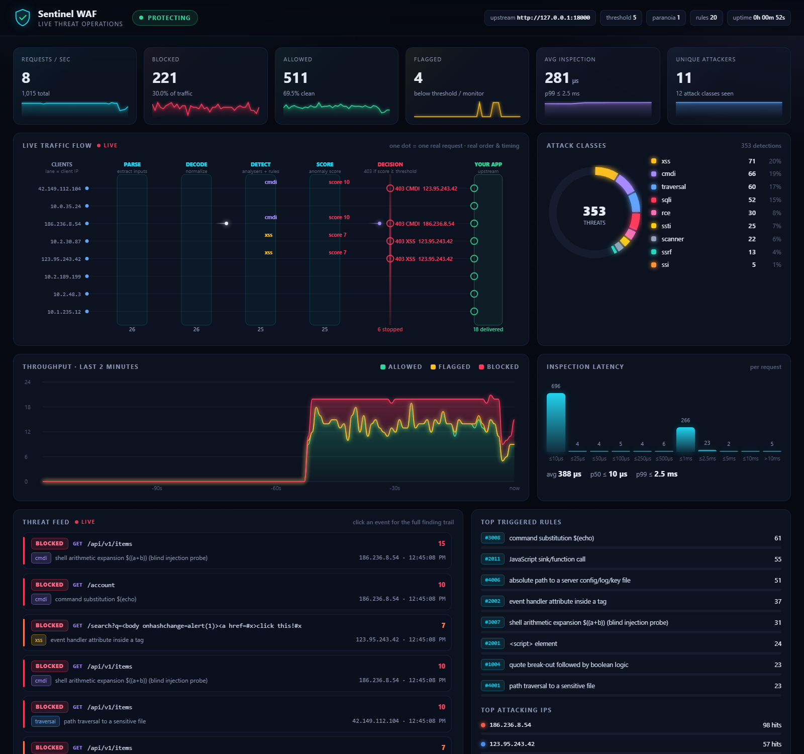
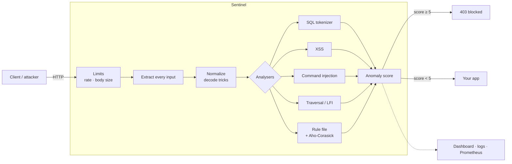
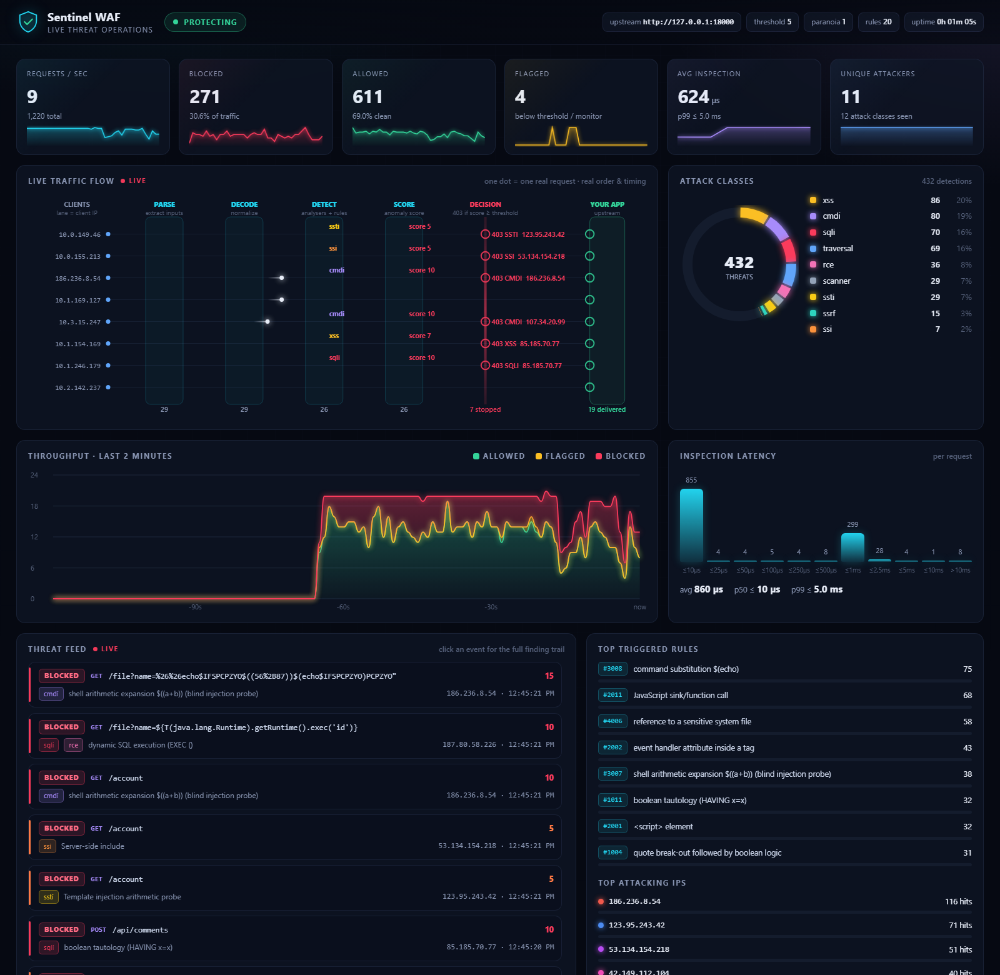
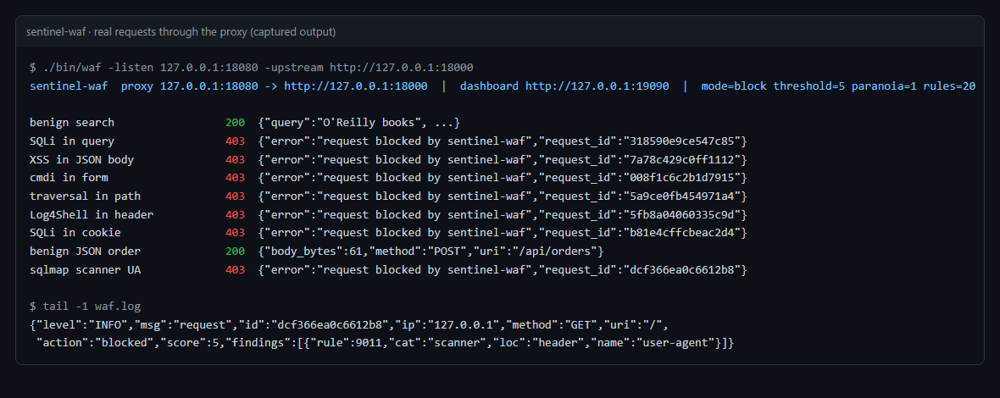

# How Sentinel WAF works

This document walks through what happens to a request from the moment it reaches Sentinel to the moment it is either blocked or passed on to your app. It also covers how I measured whether any of it works, including the parts that don't work well yet.



---

## 1. The big picture

Sentinel is a **reverse proxy**. Your users talk to Sentinel, and Sentinel talks to your app. Every request passes through a pipeline that pulls out everything an attacker could control, decodes it, analyses it and adds up a risk score. If the score reaches the threshold (5 by default), the request gets a `403` and never touches your app.



It is written in Go, uses only the standard library, and runs as a single binary.

---

## 2. Step by step

### Step 1: Limits
Before any inspection happens, Sentinel enforces a maximum body size (1 MiB by default, `413` above that) and an optional per-IP **token-bucket rate limit** (`429`). This stops the cheapest abuse before any CPU is spent on it.

### Step 2: Pull out every input
Attackers put payloads wherever a WAF doesn't look, so Sentinel extracts **every** user-controllable value, each tagged with where it came from:

| Location | Example |
|---|---|
| Path, and each decoded path segment | `/static/..%2f..%2fetc%2fpasswd` |
| Query parameters, **and their names** | `?q=…`, `?user[$ne]=1` |
| Form fields | `username=admin'--` |
| JSON, walked recursively, including keys | `{"a":{"b":["…"]}}` |
| XML text and attributes, plus the raw body for XXE | `<!ENTITY xxe SYSTEM …>` |
| Multipart fields, plus the **raw** upload filename | `filename="../../shell.php"` |
| Headers | `X-Api-Version: ${jndi:ldap://…}` |
| Cookies, parsed leniently | `pref=' or '1'='1` |

Two details matter here:
- Go's own parsers silently **drop** malformed input. A query containing `;` is discarded, and cookie values with quotes vanish. An attacker can exploit that, so whenever parsing fails, Sentinel inspects the raw string too.
- Go's multipart `FileName()` strips directories, which would hide `../../shell.php`. Sentinel reads the raw `Content-Disposition` header instead.

### Step 3: Normalize (undo the disguise)
Filters get bypassed by encoding a payload so it no longer looks like itself. Before analysis, every value is decoded, up to 4 layers deep:

| Trick | Before | After |
|---|---|---|
| Double / triple URL encoding | `%2527%2520OR` | `' or` |
| IIS `%u` encoding | `%u003cscript%u003e` | `<script>` |
| HTML entities | `&#x3c;svg&#62;` | `<svg>` |
| JS escapes | `\x3cscript>` | `<script>` |
| Overlong UTF-8 | `..%c0%af..%c0%af` | `../../` |
| Unicode look-alikes | `∕etc∕passwd`, `ʼ OR 1=1` | `/etc/passwd`, `' or 1=1` |
| Fullwidth characters | `＜script＞` | `<script>` |
| SQL comments as spaces | `UNION/**/SELECT` | `union select` |
| MySQL executable comments | `/*!50000UNION*/` | `union` |

Everything is lower-cased, NUL bytes are removed and whitespace is collapsed. Newlines are kept, because a newline is a command separator in a shell.

### Step 4: Analyse

#### SQL injection: a tokenizer, not keyword matching
Most simple WAFs search for words like `select` or `or`. That blocks real users named O'Brien and misses anything slightly disguised. Sentinel reads the input **the way a database would**, turning it into tokens: strings, numbers, keywords, operators, comments and functions.

The key idea is that the WAF doesn't know where your app will paste the value. It might be `WHERE id=<here>` or `WHERE name='<here>'`. So Sentinel tokenizes each value **three times**: as-is, as if it started inside `'…'`, and as if it started inside `"…"`. An injection is when the token stream **breaks out** of that context into real SQL structure:

```
input:   admin' OR '1'='1
as '…':  [string "admin"] [OR] [string "1"] [=] [string "1"]
                         └─ quote closed, then a boolean condition → injection
```

What counts as a real break-out:
- a quote followed by a real condition (`OR 1=1`, `AND x IS NULL`, `OR name LIKE '%a'`)
- a quote followed by a short comment terminator (`admin'--`)
- `UNION SELECT`, stacked statements (`; DROP TABLE …`), `DECLARE @x`, `EXEC xp_cmdshell`
- tautologies (`x=x`), time-delay functions (`SLEEP`, `BENCHMARK`, `WAITFOR DELAY`, `pg_sleep`)
- references to catalog tables (`information_schema`, `sqlite_master`, …)

What deliberately does **not** count, because these lines came up as false positives while testing on real novels:
- `"And he is admirably suited for it"`: "and" followed by English, not a condition
- `"--and when she had"`: a dash in prose, not a comment terminator
- `"Having once spotted my man"`: no `HAVING 1=1`, so just a sentence

#### XSS
XSS detection looks for things a **browser will actually execute**: `<script>`, event handlers inside a tag (`<svg/onload=…>`), attribute break-outs (`" onmouseover="…`), JavaScript string break-outs (`'-alert(1)-'`), `javascript:` URLs (even written as `java&#x09;script:`), embedding tags with a source (`<iframe src>`, `<object data>`, `<base href>`), CSS `expression()` and AngularJS sandbox escapes. Writing "how to use onclick in react" in a search box is fine.

#### Command injection
Sentinel scans once for shell separators (`;` `|` `&` `` ` `` newline `$(`) and looks at the next shell word:
- **Unambiguous commands** (`whoami`, `wget`, `bash`, `powershell`, …) block immediately.
- **Commands that are also English words** (`cat`, `find`, `sleep`, `echo`) need shell-style arguments (`; cat /etc/passwd`, `; sleep 10`), so "cats & dogs" and "eat; sleep; repeat" pass.
- **Blind-injection probes**: `$((7+73))` arithmetic, `$(echo …)`, `${IFS}` whitespace tricks, `if [ … -ne … ]`, and reverse shells (`/dev/tcp/`, `nc -e`).

This step uses table lookups rather than regexes, which made it about 3× faster.

#### Path traversal and file inclusion
Sentinel counts `../` sequences (including `..\`, `..;/` and the decoded variants above) and checks what they point at: `/etc/passwd`, `win.ini`, `.ssh/`, `.env`, config/log/key files and server source (`.php`, `.config`). It also blocks stream wrappers (`php://`, `expect://`, `zip://`, `file://`) and direct absolute paths to sensitive files in parameters.

#### Rule file (hot-reloadable signatures)
Some attacks are naturally signature-shaped. These live in [`internal/waf/rules.json`](../internal/waf/rules.json) as 20 rules: Log4Shell, template injection (SSTI), PHP code injection, OGNL/SpEL, XXE, SSRF to cloud metadata, `gopher://` smuggling, NoSQL operators, scanner User-Agents, CRLF injection, Shellshock, prototype pollution, LDAP, SSI, webshell uploads, XPath and request smuggling. Edit the file and Sentinel reloads it within 2 seconds. A broken edit is rejected and the old rules stay active.

Running 20 regexes on every value was originally **68% of all CPU time**. The fix is an **Aho-Corasick automaton**, which I wrote and compiled to a full DFA. Each rule lists literals at least one of which must appear (for example `${` for Log4Shell). One linear pass over the value finds every literal at once, and only the few rules that could possibly match run their regex. A test checks that this shortcut never hides a real match.

### Step 5: Score and decide
Each finding adds points using the same severity scale as the OWASP Core Rule Set: critical 5, error 4, warning 3, notice 2. One critical finding reaches the default threshold of 5. Several weak signals can also add up. For example, `select … from` (3 points) plus a catalog table name (4 points) adds up to 7.

| Option | What it does |
|---|---|
| `-threshold` | Lower means stricter |
| `-paranoia 1–4` | Turns on noisier checks |
| `-monitor` | **Shadow mode**: scores and logs everything but never blocks. This is how you'd roll a WAF out safely in front of a real app. |

---

## 3. The dashboard

Open `http://127.0.0.1:9090` while Sentinel runs. Everything updates every second.



| Panel | What it shows |
|---|---|
| **Header** | Protecting or monitoring status, upstream, threshold, paranoia level, rule count, uptime |
| **KPI cards** | Requests per second, blocked, allowed, flagged (scored but under the threshold), average inspection time and p99, unique attacker IPs. Each card has a 40-second sparkline. |
| **Live traffic flow** | **One dot is one real request**, replayed in its real order and timing from the server timestamps, all at the same speed. Each active client IP gets its own lane. A dot moves through the actual pipeline: **PARSE, DECODE, DETECT, SCORE, DECISION, YOUR APP**. It stays white until DETECT, which is where Sentinel learns what it is; there it takes its attack colour and label. SCORE shows its real anomaly score. At DECISION a blocked request stops with `403 <class> <ip>`, and an allowed one turns green and continues to the app. Each stage column counts the requests that have passed it. Nothing in this view is random or decorative. |
| **Attack classes** | Animated donut chart of detections by category |
| **Throughput** | Allowed, flagged and blocked requests per second over the last 2 minutes. Hover for exact numbers. |
| **Inspection latency** | Histogram of how long inspection took per request |
| **Threat feed** | Newest threats first. **Click any event** to see the full finding trail: which rule fired, its message, **exactly which parameter** it was found in (e.g. `query:name`) and how many points it added. |
| **Top rules / attacker IPs / locations** | Which rules fire most, who attacks most, and where payloads hide |

To see it with live traffic:
```bash
./bin/target -listen 127.0.0.1:8000
./bin/waf -listen 127.0.0.1:8080 -upstream http://127.0.0.1:8000 -trust-xff
./bin/trafficgen -url http://127.0.0.1:8080 -rps 20 -attacks 0.35   # mixed real attacks + normal users
```

Each blocked request is also written as one JSON log line, and the same request ID is returned to the client, so a user's complaint can be matched to the exact rule:
```json
{"msg":"request","id":"dcf366ea0c6612b8","ip":"127.0.0.1","method":"GET","uri":"/",
 "action":"blocked","score":5,"findings":[{"rule":9011,"cat":"scanner","loc":"header","name":"user-agent"}]}
```



---

## 4. How I measured it

I didn't want a demo that only works on payloads I wrote myself, so there are three separate tests.

**1. Built-in regression corpus** (`eval/corpus`, written by me: 173 attacks and 134 tricky benign lines). This runs as a unit test on every commit, so a change that breaks detection or causes a false positive fails CI. It proves nothing about real-world performance, because I wrote both the attacks and the detector.

**2. Third-party data I did not write.**
- **Attacks:** SecLists (SQLi, XSS, LFI and 8,262 commix command injections).
- **Normal traffic:** 37,728 lines from two full public-domain novels, 2,454 real browser User-Agents, 4,751 web paths and 10,735 names. Novels are a brutal false-positive test because they are full of apostrophes, quotes, "and", "or", semicolons and dashes.

Every payload is placed in the query, a form, JSON and a header. Sentinel and **OWASP Coraza + Core Rule Set v4.25** (the open-source WAF most people deploy) get the exact same requests in the same process. These are GitHub CI numbers on Linux:

| | Sentinel | Coraza + CRS v4 |
|---|---|---|
| Detection (query + form + JSON) | **83.1%** | 71.1% |
| False positives | **0.0%** | 0.3% |
| Mean / p99 latency per request | **46 µs / 193 µs** | 1.19 ms / 4.93 ms |

On the full unsampled set, Sentinel wrongly blocks **4 of 150,912** benign requests.

**3. GoTestWAF**, Wallarm's independent WAF test suite, which runs against the live proxy in CI. This is the hardest test, and it's where Sentinel looks weakest:

| | Score |
|---|---|
| Attacks blocked (application security) | 46% (44% before the padding fix) |
| API attacks blocked | 57% |
| Normal requests passed | 97.9% |
| **Overall** | **64.5%** |

GoTestWAF re-encodes the same payload in many ways (Base64, JS Unicode, XML entities) and places it in gRPC, GraphQL, SOAP and multipart bodies, so it exercises a much wider attack surface than the other tests. It also found **a real bug**: payloads hidden behind more than 16 KB of padding got through, because inspection stopped at 16 KB. That's now fixed: all 12 padded tests (16 KB to 128 KB) are blocked, and a regression test covers it.

---

## 5. Known gaps (the honest list)

From GoTestWAF and the third-party misses (`go run ./cmd/eval -corpus eval/external -misses misses.tsv` lists every one):

- **NoSQL injection (10%) and mail-header injection (0%):** only basic operator detection exists so far.
- **Base64 / JS-Unicode encoded payloads:** Sentinel doesn't try decoding Base64. CRS doesn't either, but some commercial WAFs do.
- **XSS in unusual encodings (36% on GoTestWAF):** much better on SecLists (98.6%) than on GoTestWAF's encoders.
- **Path traversal on raw wordlists (64.5%):** many list entries aren't attacks at all (e.g. `..2f..2f` with the `%` missing), but a proper path canonicalizer would still help.
- **Multipart LFI and GraphQL/gRPC bodies:** not parsed specially yet.
- **No response inspection:** Sentinel looks at requests only.

The next steps are in that order. Each fix gets a regression test, and the GoTestWAF score in CI shows whether it worked.

---

## 6. Performance notes

The first working version took **2.9 ms** per request on my 2012 i3 laptop. Profiling with `pprof` showed where the time went, and four changes brought it to about **0.16 ms** (46 µs on CI hardware):

1. **Aho-Corasick prefilter for the rule file:** 68% of CPU went on regexes that couldn't match.
2. **Command injection via separator scan and word-table lookup** instead of unanchored regexes.
3. **Cheap literal checks before every remaining regex.** One check was `ContainsAny(s, "e-b@")`, which is true for almost any English text, so the regex behind it ran on everything. Profiling caught it.
4. **The scanner User-Agent rule** moved behind the prefilter. A 30-word regex had been running on every User-Agent.

```bash
go test -bench . -benchmem ./internal/waf/                     # engine benchmarks
go test -run '^$' -bench . -cpuprofile cpu.prof ./internal/waf/ && go tool pprof -top cpu.prof
```

---

## 7. Code map

| Path | What's there |
|---|---|
| `cmd/waf` | The proxy binary and its flags |
| `cmd/target` | A safe demo upstream. It *shows* the SQL or shell command it would run, but never runs anything. |
| `cmd/trafficgen` | Replays real attack and benign corpora from many IPs, for demos |
| `cmd/eval` | Detection and false-positive harness. Lists every miss. |
| `bench/compare` | Head-to-head with Coraza + CRS (separate module, so the WAF itself stays dependency-free) |
| `internal/normalize` | All decoding and canonicalization |
| `internal/detect` | SQLi tokenizer, XSS, command injection, traversal |
| `internal/ahocorasick` | Multi-pattern matcher compiled to a DFA |
| `internal/waf` | Input extraction, rule file, scoring engine |
| `internal/server` | Proxy, rate limiter, metrics, dashboard |
| `.github/workflows/ci.yml` | Tests, benchmarks, both evaluations, the CRS comparison and GoTestWAF on every push |
